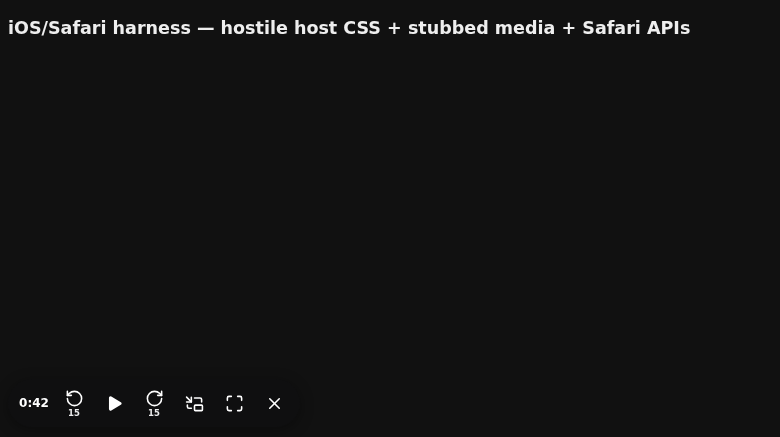

# JFF Theater — Resume + Playback Controls

A userscript that gives the [JFF Theater](https://jff.jpf.go.jp/) film player something it has never
had: it remembers where you were.

JFF Theater streams Japanese films for free (registration required) through a Wowza-based player that
keeps no progress and no resume feature. Reload the page, lose Wi-Fi, or have Safari discard the tab,
and a 119-minute film starts again at 00:00. This script stores the playback position per film and
seeks back to it.

It is a **streaming convenience**, not a downloader: no media is fetched, copied, saved or decrypted —
only a time offset is stored. Public performance and redistribution of the films remain subject to the
Japan Foundation's terms and to copyright law.

## Features

- **Resume** — saves your position every few seconds and after a pause, then jumps back to it when the
  page reloads. A time chip shows where you are; tap it to jump to the last watched point.
- **On-screen controls** (touch-friendly): −15s, play/pause, +15s, picture-in-picture, fullscreen,
  and a hide button that leaves a small badge behind.
- **Keyboard shortcuts** (desktop): `←`/`→` ±10s, `Shift`+arrows ±60s, `Space`, `F`, `P`, `M`, `0`
  (restart), `T` (copy timestamp).
- **Screen wake lock** while playing, so the display does not dim mid-film.
- **Storage**: `GM.setValue` when the manager provides it, `localStorage` otherwise. One entry per
  film path, capped at the 60 most recent.

## Install

**iOS / iPadOS — Userscripts app (Safari)**

1. Install [Userscripts](https://apps.apple.com/app/userscripts/id1463298887) (free, open source) and open it once.
2. Settings → Safari → Extensions → enable **Userscripts**, allow for **All Websites**.
3. Save `jff-theater-resume.user.js` into the Userscripts folder (Files app), or open a `.user.js` URL in
   Safari and install from the extension popup.
4. Open a film on JFF Theater and press play — the control bar appears bottom-left.

**Desktop — Tampermonkey / Violentmonkey / Safari**

Install the same file; the bar and keyboard shortcuts both work.

## Limitations

- The resume seek was verified against a stubbed player, **not** against the production DRM stream —
  the site's player is behind a login. If the seek does not land, check the console for `[jff-resume]`
  lines.
- Picture-in-picture is blocked by some DRM playback paths; the button reports when it fails.
- The player element is located by `document.querySelectorAll('video')`. If JFF rewrites its player,
  this needs updating.

## Development

`stub.html`, `stub-ios.html` and `stub-hostile.html` are harness pages used to exercise the script's
logic in a real browser (stubbed media element, Safari-only APIs, and a copy of JFF's own CSS rules
that used to distort the icons). `rangeserver.py` is a small Range-capable static server, because
Chrome's media loader stalls on `python3 -m http.server`. `legacy/` holds the earlier keyboard-only
build, kept for reference only.

## Licence

MIT — see `LICENSE`.

Icon path data from [Lucide](https://lucide.dev), used under the ISC Licence,
Copyright (c) Lucide Contributors.
