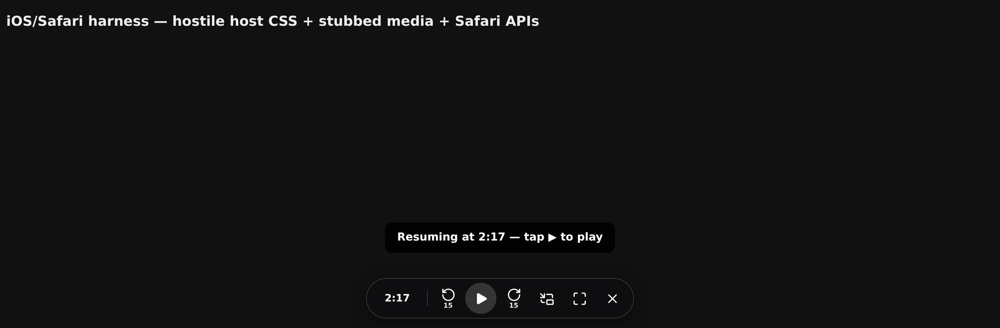

# JFF Theater — Resume + Playback Controls

A userscript that gives the [JFF Theater](https://jff.jpf.go.jp/) film player something it has never
had: it remembers where you were.

JFF Theater streams Japanese films for free (registration required) through a Wowza-based player that
keeps no progress and no resume feature. Reload the page, lose Wi-Fi, or have Safari discard the tab,
and a 119-minute film starts again at 00:00. This script stores the playback position per film and
seeks back to it.

It is a **streaming convenience**, not a downloader: no media is fetched, copied, saved or decrypted —
only a time offset is stored. Public performance and redistribution of the films remain subject to the
Japan Foundation's terms and to copyright law.

## Features

- **Resume** — saves your position every few seconds and after a pause, then jumps back to it when the
  page reloads. A time chip shows where you are; tap it to jump to the last watched point.
- **On-screen controls** (touch-friendly): −15s, play/pause, +15s, picture-in-picture, fullscreen,
  and a hide button that leaves a small badge behind. The bar is a centred floating pill — same surface
  as the resume hint — with a hairline divider after the time and a filled play button for the primary
  action; button sizes use `clamp()` so it still fits a 320 px phone without wrapping.
- **Keyboard shortcuts** (desktop): `←`/`→` ±10s, `Shift`+arrows ±60s, `Space`, `F`, `P`, `M`, `0`
  (restart), `T` (copy timestamp).
- **Screen wake lock** while playing, so the display does not dim mid-film.
- **Storage**: `GM.setValue` when the manager provides it, `localStorage` otherwise. One entry per
  film path, capped at the 60 most recent.

## Install

**iOS / iPadOS — Userscripts app (Safari)**

1. Install [Userscripts](https://apps.apple.com/app/userscripts/id1463298887) (free, open source) and open it once.
2. Settings → Safari → Extensions → enable **Userscripts**, allow for **All Websites**.
3. Save `jff-theater-resume.user.js` into the Userscripts folder (Files app), or open a `.user.js` URL in
   Safari and install from the extension popup.
4. Open a film on JFF Theater and press play — the control bar appears centred at the bottom.

**Desktop — Tampermonkey / Violentmonkey / Safari**

Install the same file; the bar and keyboard shortcuts both work.

**Home Screen icon on iOS — read this before you add one**

A website added to the Home Screen as a *web app* runs in its own standalone container, and **Safari
extensions cannot run there** — Apple provides no setting for it (macOS web apps do support extensions;
iOS and iPadOS do not). So the plain web app icon will never show the resume pill or the control bar.

Add it the other way round instead:

1. Open the film or `https://id.jff.jpf.go.jp/` in Safari.
2. Share → **Add to Home Screen**.
3. Turn **Open as Web App** *off*. (iOS 26 and later turns it on by default, so check it.)
4. Tap **Add**.

The icon looks the same, but tapping it opens the site as a normal Safari tab — where Userscripts is
active and the script runs. If you already added it as a web app, delete that icon first, then repeat
the steps above; the standalone container keeps its own storage, so the saved position would not carry
across anyway.

## Troubleshooting (iOS "Userscripts" app)

The app only learns about scripts when **its own popup loads the scripts directory**. After dropping a
`.user.js` file in — from Files, iCloud, an editor — open the extension popup once (Safari `AA` button
→ Extensions → Userscripts). Until you do, the file sits on disk and is never injected, which looks
exactly like "the script is not detected".

Checklist:

1. The file must be in the directory the app was pointed at (`Set Userscripts Directory`; set
   automatically since iOS app v1.5.0). A file saved from Telegram lands in Downloads, **not** there.
2. The extension must be enabled and allowed for the site: Settings → Safari → Extensions →
   Userscripts → *Always Allow* for *All Websites*.
3. Open the extension popup and let it load completely — that is what rescans the directory.
4. In the popup, check the matched-userscripts list for the page, and turn on *Show Toolbar Count* in
   the app settings: the toolbar badge shows how many enabled scripts match the current URL. **Zero**
   means the `@match` pattern is not matching (or the script is toggled off) — not that the script is
   broken.
5. On iOS 18+ keep an iCloud folder downloaded (*Keep Downloaded*); an evicted file can be unreadable.
6. Still nothing? Install `jff-check.user.js` from this repository: it draws a banner on any JFF page
   proving a manager injected code, and reports the manager name and version. If even that banner is
   missing, the problem is the app's directory or permissions, not this script.
7. The script works in either injection context. If the app uses `@inject-into auto` and lands in the
   page context, `GM.setValue` is unavailable (that is an app rule, not a bug) and the script falls
   back to `localStorage` automatically.

Visible signs it is running: the control bar appears over the player once you press play, and a film
you have already started shows a small **Resume 42:10** pill even before the player exists.

## Development

`stub.html`, `stub-ios.html` and `stub-hostile.html` are harness pages used to exercise the script's logic in a real browser (a stubbed
media element, Safari-only APIs, and a copy of JFF's own CSS rules that used to distort the icons).
`rangeserver.py` is a small Range-capable static server, because Chrome's media loader stalls on
`python3 -m http.server`. `legacy/` holds the earlier keyboard-only build, kept for reference only.

## Licence

MIT — see `LICENSE`.

Icon path data from [Lucide](https://lucide.dev), used under the ISC Licence,
Copyright (c) Lucide Contributors.
